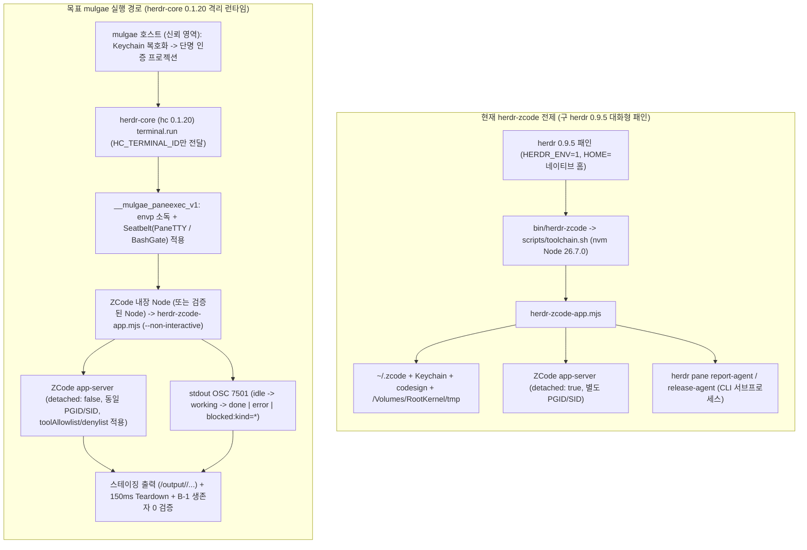

# `mulgae`의 `herdr-core` 기반 ZCode 전환을 위한 `herdr-zcode` 갭 분석 보고서

- **작성일**: 2026-11-23
- **조사 대상**:
  - `herdr-zcode` (`HEAD b8cc83a`, `/Volumes/RootKernel/RootKernel/aquarium-tools/herdr-zcode`)
  - `mulgae` (`HEAD 0e05ac2`, `/Volumes/RootKernel/RootKernel/aquarium-tools/mulgae`, `EPIC-017` Grok `herdr-core` 전환 완료 시점)
  - 호스트 런타임 환경: `herdr-core` (`hc 0.1.20`), 레거시 `herdr 0.9.5`, `/Applications/ZCode.app` (`3.18.2`, 번들 `zcode.cjs` 프로토콜 `0.17.1`)

---

## 1. 핵심 요약 (Executive Summary)

### 최종 판정: **현재 `herdr-zcode`는 `mulgae`의 `herdr-core` 기반 ZCode 런타임으로 그대로 사용할 수 없다.**

`herdr-zcode`는 본래 **레거시 `herdr 0.9.5`의 대화형(interactive) 패인**에서 사람이 ZCode를 조작하는 브리지로 설계되었다. 반면 `mulgae`가 Grok 마이그레이션(`EPIC-017`)으로 확립한 `herdr` 베이스는 **`herdr-core 0.1.20` (`hc`) + `__mulgae_paneexec_v1` 트램펄린 + macOS Seatbelt(`PaneTTY` / `BashGate`) 기반의 무인·격리·fail-closed 터미널 런타임**이다.

이 전제 차이로 인해 현재 `herdr-zcode`를 그대로 연결하면 **기동 즉시 크래시하거나, 턴 완료를 영원히 감지하지 못하거나, 실패를 성공으로 오인하거나, 고아 프로세스로 B-1 보안 검증에 실패**한다. 다만 ZCode Desktop `app-server` NDJSON 프로토콜 제어·계정 오버레이·스트림 레댁션 등 핵심 기반은 이미 잘 갖춰져 있으므로, 본 보고서에 정리한 **P0 차단 요인 해소 및 기능 추가**를 거치면 `mulgae`의 공식 `herdr-core` 기반 ZCode 실행기로 충분히 통합할 수 있다.

### 한눈에 보는 기능 충족 현황표 (Gap Matrix)

| 영역 | `mulgae` (`herdr-core` 베이스) 요구사항 | `herdr-zcode` 현재 상태 | 판정 | 우선순위 |
| --- | --- | --- | --- | --- |
| **상태 보고 프로토콜** | `herdr-core` **OSC 7501** (`idle`/`working`/`done`/`blocked:kind=*`/`error`), `Terminal.reported == true` 필수 | 레거시 `herdr 0.9.5` CLI(`herdr pane report-agent`)만 지원, OSC 7501 미방출 | **불가 (치명적)** | **P0** |
| **턴 실패 분류** | `turn.failed` / `error_*` 시 `error` 또는 `blocked:kind=quota\|rate_limit\|auth` 보고 | 실패 시 `this.current = null` 후 **`idle` 보고** (`herdr-core`가 성공 턴 완료로 오인) | **버그 (치명적)** | **P0** |
| **프로세스 트리 & Teardown** | `SIGHUP` 후 150ms 내 종료 및 동일 PGID/SID 회수, B-1 생존 프로세스 0개 | `detached: true` (`setsid`)로 자식 분리 + 15s RPC 종료 대기 → **고아 프로세스 잔존** | **불가 (보안 실패)** | **P0** |
| **Seatbelt 임시 경로** | `WritableRoot` / `RuntimeTempRoot` (`/tmp/mulgae-zcode`) 내부만 쓰기 허용 | `/Volumes/RootKernel/tmp` 하드코딩 우선 사용 → `EPERM` 즉시 실패 | **불가 (치명적)** | **P0** |
| **크리덴셜 & Keychain** | 네이티브 `~/.zcode` 및 `~/Library/Keychains` 커널 차단, 샌드박스 내 Keychain/`codesign` 불가 | 패인 내부에서 `~/.zcode/v2/*` 직접 읽기 + `/tmp` 복사 + `codesign` + Keychain 접근 | **불가 (보안 충돌)** | **P0** |
| **런처 & Node 툴체인** | 빈 임시 `HOME`(오프라인 `--version`), `NVM_DIR` 미설정·`PATH=/usr/bin:/bin`(`paneexec`)에서 기동 | `${NVM_DIR:-$HOME/.nvm}/.../v26.7.0/bin/node` 및 `process.versions.node === '26.7.0'` 강제 | **불가 (치명적)** | **P0** |
| **자식 환경변수 격리** | 자식 `app-server` 및 `Bash` 도구에 `HC_*` 미전달 | `HERDR_*`만 제거하고 **`HC_*` 미제거** | **부족 (위험)** | **P0** |
| **목적별 도구 제어** | `toolAllowlist`(빈 배열 `[]` 포함), `toolDenylist`, MCP/타이틀생성/서브에이전트/워크플로우 비활성화 | `session/create`에 `{ workspace, mode }`만 전송 (도구·MCP·타이틀 제어 없음) | **미지원** | **P0** |
| **비대화형 권한·질문 처리** | 질문 자동 해소(`askUserQuestionAutoResolutionEnabled: true`), 예상치 못한 권한 요청 시 영구 대기 금지 | `askUserQuestionAutoResolutionEnabled: false`, 인터랙션 시 stdin `/allow`·`/answer` 무한 대기 | **부족** | **P0** |
| **모델 & 추론 강도 분리** | `--model` 없이 `--reasoning-effort` 단독 지정 가능, 기본 모델 유지, 적용 결과 검증 | `DEFAULT_MODEL` 강제, `$level`만 파싱, `reasoningLevel` 미검증, `session/setThoughtLevel` 미지원 | **부족** | **P1** |
| **출력 스테이징 / 추출** | `<scratch>/output/<id>/{role-report.md,extraction.json,probe.json}` + 완료 nonce 검증 | stdout 스트리밍 출력만 존재 (`--output-file` 미지원, 모델 `Write` 사용 시 도구 허용 필요) | **설계 결정 필요** | **P1** |
| **`mulgae` 측 연동 제약** | `BashGate` `process-exec` 정규식, `RuntimeTempRoot`, `doctor`, `zcodeTerminalProfile` | `BashGate`가 `herdr*` 바이너리 실행 자체를 차단 (`live_boundary_darwin.go:250`) | **동반 수정 필수** | **P0** |

---

## 2. 아키텍처 갭 분석: 구 `herdr 0.9.5` vs `mulgae`의 `herdr-core 0.1.20`

`mulgae`는 `EPIC-017`에서 Grok을 `herdr-core` 기반 터미널 런타임으로 전환하면서 엄격한 보안·관측·수명주기 계약을 확립했다([herdr-core-terminal-transport.md](file:///Volumes/RootKernel/RootKernel/aquarium-tools/mulgae/docs/architecture-decision-records/herdr-core-terminal-transport.md), [terminal_provider.go](file:///Volumes/RootKernel/RootKernel/aquarium-tools/mulgae/internal/adapters/providercli/terminal_provider.go)).



### 핵심 전제 차이

| 항목 | 현재 `herdr-zcode` | `mulgae` (`herdr-core` 터미널 런타임) |
| --- | --- | --- |
| **터미널 멀티플렉서** | 레거시 `herdr 0.9.5` (`HERDR_*` 환경변수) | `herdr-core 0.1.20` (`HC_SOCKET`·`HC_TERMINAL_SOCKET`은 `paneexec`에서 제거, 검증된 `HC_TERMINAL_ID`만 유지) |
| **상태 관측 방식** | 자식 프로세스로 `herdr pane report-agent` 호출 | PTY stdout의 **OSC 7501 시퀀스**를 `herdr-core`가 파싱하여 `Terminal.status`·`Terminal.turn`·`Terminal.reported`로 노출 |
| **프로세스 회수** | `SIGHUP` 후 최대 30초(`session/stop` + `session/close`) 대기 후 `groupPid` 종료 | `terminal.kill`(`SIGHUP`) → **150ms 대기** → `-panePID` 및 `paneSID`에 `SIGKILL` → B-1 센티널 생존자 전수 검사 |
| **파일시스템/권한** | 네이티브 `HOME`·`Keychain`·`/Volumes/RootKernel/tmp` 자유 접근 | `HOME=<namespace>/home`, 네이티브 `~/.zcode`·`~/Library/Keychains` 커널 차단, 지정 `WritableRoot`/`RuntimeTempRoot` 외 쓰기 차단 |
| **입력/출력 계약** | 사람이 대화형으로 프롬프트 및 `/allow`·`/answer` 입력 | `terminal.send` 1회 주입 → `<scratch>/output/<id>/*` + `MULGAE_COMPLETE:<nonce>` 사후 검증 |

---

## 3. 반드시 수정해야 할 기존 기능 (Modifications to `herdr-zcode`)

### M-1 [P0] 상태 보고 프로토콜 전환 및 턴 실패 오분류 버그 수정

- **대상 파일**: [lib/herdr-reporter.mjs](file:///Volumes/RootKernel/RootKernel/aquarium-tools/herdr-zcode/lib/herdr-reporter.mjs#L1-L135), [lib/app-server-controller.mjs](file:///Volumes/RootKernel/RootKernel/aquarium-tools/herdr-zcode/lib/app-server-controller.mjs#L39-L47), [lib/app-server-controller.mjs](file:///Volumes/RootKernel/RootKernel/aquarium-tools/herdr-zcode/lib/app-server-controller.mjs#L318-L330)
- **현재 문제점**:
  1. **OSC 7501 전면 부재**: `createHerdrReporter()`는 `HERDR_ENV === '1'`, `HERDR_BIN_PATH`, `HERDR_PANE_ID`, `HERDR_SOCKET_PATH`가 없으면 no-op 리포터를 반환한다([herdr-reporter.mjs](file:///Volumes/RootKernel/RootKernel/aquarium-tools/herdr-zcode/lib/herdr-reporter.mjs#L8-L11)). `mulgae`는 `RequireOSCReporting() == true`를 강제하므로 `Terminal.reported == false`로 **100% `provider_spawn_failed` 또는 기동 타임아웃 실패**가 발생한다([terminal_provider.go](file:///Volumes/RootKernel/RootKernel/aquarium-tools/mulgae/internal/adapters/providercli/terminal_provider.go#L882-L896)).
  2. **치명적 버그 — 턴 실패 시 `idle` 보고로 인한 "거짓 성공"**: [app-server-controller.mjs](file:///Volumes/RootKernel/RootKernel/aquarium-tools/herdr-zcode/lib/app-server-controller.mjs#L318-L330)에서 `turn.failed` 또는 `resultType.startsWith('error_')`가 발생하면 `this.failed = true`만 설정한 뒤 `this.current = null`로 지우고 `this.report()`를 호출한다. `state()`는 `this.failed`를 보지 않으므로 **`idle`을 반환**한다. `herdr-core`에서 `working -> idle` 전이는 턴 완료(`turn >= 1`)로 처리되며, `mulgae`의 `classifyOSCTerminalOutcome()`([terminal_provider.go](file:///Volumes/RootKernel/RootKernel/aquarium-tools/mulgae/internal/adapters/providercli/terminal_provider.go#L983-L1002))은 `idle` + `TurnCount() >= 1`을 **정상 성공**으로 판정한다.
  3. **상태 어휘 부족**: 현재 상태 집합은 `idle | working | blocked | unknown` 4개뿐이며([herdr-reporter.mjs](file:///Volumes/RootKernel/RootKernel/aquarium-tools/herdr-zcode/lib/herdr-reporter.mjs#L4)), `herdr-core`의 `done`, `error` 및 `blocked`의 세부 `kind`(`auth`, `quota`, `rate_limit`, `permission`, `question`)가 없다.
  4. **기동 단계 실패 시 분류 손실**: [herdr-zcode-app.mjs](file:///Volumes/RootKernel/RootKernel/aquarium-tools/herdr-zcode/bin/herdr-zcode-app.mjs#L184-L190)에서 기동 중 인증 실패나 모델 불가 에러가 발생하면 OSC 보고 없이 `exit 1`한다. `mulgae`는 `ExitedBeforeReport()` 시 exit code와 화면 내용을 무시하고 무조건 `provider_spawn_failed`로 분류한다([terminal_provider.go](file:///Volumes/RootKernel/RootKernel/aquarium-tools/mulgae/internal/adapters/providercli/terminal_provider.go#L873-L896)).
- **수정 방향**:
  - `AppServerController`에 턴 결과 상태(`lastOutcome`: `done` / `error` / `blocked` + `blockedKind` + `diagnostic`)를 명시적으로 유지하도록 변경.
  - `turn.completed`(정상 완료) → `done` 보고(이후 새 입력 수신 시 `working` 전이).
  - `turn.failed` 또는 `error_*` → `safeErrorSummary`의 `businessCode`/`status`/`reason`을 기반으로 아래 매핑 적용:
    - `provider_code=1308` / `insufficient_quota` → `blocked:kind=quota`
    - `provider_code=1302` / `HTTP 429` / `rate_limited` / `rate_limit_exceeded` → `blocked:kind=rate_limit`
    - `HTTP 401` / `auth_failed` / `invalid_api_key` / `model_request_auth_missing` → `blocked:kind=auth`
    - `permission_denied` / 비대화형 권한 차단 → `blocked:kind=permission`
    - 그 외 실패 → `error` (+ 화면에 안전한 공개 에러 코드 출력하여 `nativeProviderOutcome()` 보조 분류 가능하게 유지).
  - 비대화형 `herdr-core` 모드에서는 기동 단계 인증 결함 발생 시 즉시 종료 대신 `blocked:kind=auth`를 방출하고 호스트의 teardown을 대기하는 옵션(Grok의 `osc_blocked_auth` 패턴과 동일, [live_herdr_darwin_test.go](file:///Volumes/RootKernel/RootKernel/aquarium-tools/mulgae/internal/adapters/herdr/live_herdr_darwin_test.go#L111-L114))을 제공.

---

### M-2 [P0] `detached: true` 자식 프로세스 격리 해제 및 150ms Teardown 호환화

- **대상 파일**: [lib/app-server-client.mjs](file:///Volumes/RootKernel/RootKernel/aquarium-tools/herdr-zcode/lib/app-server-client.mjs#L42-L61), [lib/app-server-client.mjs](file:///Volumes/RootKernel/RootKernel/aquarium-tools/herdr-zcode/lib/app-server-client.mjs#L139-L186), [bin/herdr-zcode-app.mjs](file:///Volumes/RootKernel/RootKernel/aquarium-tools/herdr-zcode/bin/herdr-zcode-app.mjs#L99-L118), [lib/app-server-controller.mjs](file:///Volumes/RootKernel/RootKernel/aquarium-tools/herdr-zcode/lib/app-server-controller.mjs#L353-L365)
- **현재 문제점**:
  1. `AppServerClient.start()`는 Unix에서 항상 `detached: true`(`setsid()`)로 `ZCode app-server`를 기동한다([app-server-client.mjs](file:///Volumes/RootKernel/RootKernel/aquarium-tools/herdr-zcode/lib/app-server-client.mjs#L45-L48)). 이로 인해 `ZCode`는 패인의 프로세스 그룹(`panePID`) 및 세션(`paneSID`) 바깥으로 탈출한다.
  2. `herdr-core` 공식 동작(`hc --skill` 확인)은 **`hc kill` / 패인 종료 시 detached 프로세스를 회수하지 않는다**.
  3. `mulgae`의 `teardownPane()`은 `terminal.kill`(`SIGHUP`) 전송 후 **`postKillGraceDuration = 150ms`**만 기다리고 `-panePID`와 `paneSID` 소속 프로세스에 `SIGKILL`을 보낸다.
  4. 그런데 `herdr-zcode`의 `SIGHUP` 핸들러는 `shutdown()`([app-server-controller.mjs](file:///Volumes/RootKernel/RootKernel/aquarium-tools/herdr-zcode/lib/app-server-controller.mjs#L353-L365))을 호출하여 `session/stop`(최대 15초)과 `session/close`(최대 15초) RPC를 순차 대기한 뒤에야 `client.terminate()`를 실행한다. 결과적으로 150ms 시점에 `herdr-zcode`만 `SIGKILL`당하고, **별도 세션에 있는 `ZCode app-server`는 그대로 살아남아 고아 프로세스가 된다**.
  5. `mulgae`의 `BashGate` B-1 Control 5 (`checkSameUIDProfileSentinelSurvivors`, `output_staging_darwin.go:407-440`)는 `MULGAE_TERMINAL_PROFILE_SENTINEL`을 환경변수에 가진 생존 프로세스가 하나라도 남으면 즉시 **`process_security` 치명적 실패(fail-closed)** 처리한다.
- **수정 방향**:
  - `AppServerClient`에 `detached: false` 옵션(CLI `--no-detach` 또는 `--non-interactive` / `HC_TERMINAL_ID` 감지 시 기본 비활성)을 추가하여 `ZCode app-server`와 그 하위 `Bash` 프로세스가 패인의 프로세스 그룹/세션(`paneSID`) 안에 머물도록 보장.
  - `SIGHUP` / `SIGTERM` 수신 시 즉시 종료 경로 구현: 긴 `session/stop`·`session/close` RPC 대기 대신 `client.child.stdin.end()` + 즉시 `SIGTERM` 전파(짧은 grace 예: 50~80ms 내 미종료 시 `SIGKILL`)로 150ms 안에 클린 종료를 완료.
  - 정상 턴 완료 후(`done` 보고 직전) 미리 `session/close`를 비동기/단축 완료해 두거나, `SIGHUP` 시점의 종료 예산을 `--shutdown-timeout-ms`로 제한.

---

### M-3 [P0] Seatbelt 호환 임시 디렉토리 및 `HC_*` 환경변수 차단

- **대상 파일**: [lib/desktop-runtime.mjs](file:///Volumes/RootKernel/RootKernel/aquarium-tools/herdr-zcode/lib/desktop-runtime.mjs#L8-L55), [bin/herdr-zcode-app.mjs](file:///Volumes/RootKernel/RootKernel/aquarium-tools/herdr-zcode/bin/herdr-zcode-app.mjs#L126-L128)
- **현재 문제점**:
  1. **하드코딩된 `/Volumes/RootKernel/tmp`**: `scratchRoot()`([desktop-runtime.mjs](file:///Volumes/RootKernel/RootKernel/aquarium-tools/herdr-zcode/lib/desktop-runtime.mjs#L8-L20))는 `/Volumes/RootKernel`이 마운트되어 있으면 `os.tmpdir()`(`TMPDIR`)보다 `/Volumes/RootKernel/tmp`를 우선 선택한다. `mulgae` Seatbelt에서는 `WritableRoot`와 `RuntimeTempRoot` 외 모든 경로 쓰기가 커널 차단되므로, `access('/Volumes/RootKernel', W_OK)`나 `mkdtemp('/Volumes/RootKernel/tmp/herdr-zcode-...')` 단계에서 즉시 **`EPERM`**이 발생한다.
  2. **`HC_*` 환경변수 유출**: [herdr-zcode-app.mjs](file:///Volumes/RootKernel/RootKernel/aquarium-tools/herdr-zcode/bin/herdr-zcode-app.mjs#L127)는 `HERDR_*`만 삭제하고 **`HC_*` (`HC_TERMINAL_ID`, `HC_SOCKET`, `HC_TERMINAL_SOCKET`, `HC_SESSION` 등)는 제거하지 않는다**. 자식 `ZCode app-server`나 ZCode가 실행하는 `Bash` 서브커맨드에 `HC_TERMINAL_ID`가 노출되면 안 된다.
  3. **`zcode-builtin.json` 불필요 복사**: 현재는 `bundled` 카탈로그를 매번 임시 디렉토리로 복사하여 `ZCODE_BUILTIN_PROVIDER_CONFIG_FILE`로 전달한다. `mulgae`가 이미 읽기전용 번들 경로 또는 네임스페이스 경로로 고정해 준 경우 불필요한 임시 디렉토리 생성을 생략할 수 있어야 한다.
- **수정 방향**:
  - `scratchRoot()`에서 `env.TMPDIR` 또는 명시적 `--runtime-dir <path>`가 지정된 경우 이를 최우선 사용하고, `/Volumes/RootKernel/tmp` 하드코딩 폴백을 제거(또는 `TMPDIR` 미설정·대화형 호스트 전용으로 제한).
  - `ZCODE_BUILTIN_PROVIDER_CONFIG_FILE`이 이미 외부에서 지정되었거나 `--no-copy-catalog`가 주어지면 복사 없이 그대로 사용(단, `zcode.cjs`가 해당 경로의 SHA-256을 `builtinRevision`에 포함하므로 `desktopAccount`와 동일 경로 일관성 유지).
  - `childEnv` 생성 시 `HERDR_*`뿐 아니라 **`HC_*` 전체**를 명시적으로 삭제.

---

### M-4 [P0] `nvm` 의존 런처 및 `Node 26.7.0` 강제 검증 완화

- **대상 파일**: [bin/herdr-zcode](file:///Volumes/RootKernel/RootKernel/aquarium-tools/herdr-zcode/bin/herdr-zcode#L1-L10), [scripts/toolchain.sh](file:///Volumes/RootKernel/RootKernel/aquarium-tools/herdr-zcode/scripts/toolchain.sh#L27-L36), [lib/toolchain.mjs](file:///Volumes/RootKernel/RootKernel/aquarium-tools/herdr-zcode/lib/toolchain.mjs#L22-L53)
- **현재 문제점**:
  1. **`nvm` 경로 하드코딩**: [scripts/toolchain.sh](file:///Volumes/RootKernel/RootKernel/aquarium-tools/herdr-zcode/scripts/toolchain.sh#L27-L28)는 `${NVM_DIR:-$HOME/.nvm}/versions/node/v26.7.0/bin/node`를 하드코딩으로 요구한다.
     - `mulgae`의 오프라인 버전 검사(`environment/executable.go:138-149`)는 **빈 임시 `HOME`**과 `NVM_DIR`/`PATH` 없이 `--version`을 실행한다 → 즉시 `Node 26.7.0 is missing`으로 실패.
     - `mulgae`의 `__mulgae_paneexec_v1`(`paneexec_darwin.go`)는 환경변수를 소독하여 `HOME=<namespace>/home`, `NVM_DIR` 미설정, `PATH=/usr/bin:/bin` 상태로 실행한다 → 즉시 크래시.
  2. **정확한 버전 일치 강제 (`=== '26.7.0'`)**: [lib/toolchain.mjs](file:///Volumes/RootKernel/RootKernel/aquarium-tools/herdr-zcode/lib/toolchain.mjs#L22-L26)의 `assertNode()`는 `process.versions.node !== '26.7.0'`이면 즉시 종료한다. 이로 인해 `ZCode.app`에 내장된 서명된 Electron Node(`ELECTRON_RUN_AS_NODE=1`, ZCode 3.18.2 기준 Node 24.x)로 `herdr-zcode-app.mjs`를 직접 실행하는 깔끔한 경로까지 차단된다.
  3. **`inspectDesktop()` 서브프로세스 오버헤드 및 경로 의존**: [lib/toolchain.mjs](file:///Volumes/RootKernel/RootKernel/aquarium-tools/herdr-zcode/lib/toolchain.mjs#L27-L53)는 기동마다 `/usr/libexec/PlistBuddy` 2회와 `ZCode -p` 1회를 실행한다. `mulgae` 호스트가 이미 `ZCode.app/Contents/Info.plist`와 바이너리 무결성을 검증한 뒤 실행하는 경우, Seatbelt 내부에서의 중복 외부 도구 실행(`PlistBuddy` 등)을 건너뛸 수 있는 옵션(`--skip-desktop-inspect` 또는 `fs.readFile` 기반 plist 파싱)이 유리하다.
- **수정 방향**:
  - `lib/toolchain.mjs`: `herdr-zcode-app.mjs`가 실제로 사용하는 Node API는 표준 ESM(`node:fs/promises`, `node:crypto`, `node:readline`, `node:child_process`)뿐이므로, 런타임 검증을 **최소 호환 버전**(예: `>= 22.0.0` 또는 `>= 24.0.0`)으로 완화하거나 `ELECTRON_RUN_AS_NODE=1`로 실행된 `ZCode` 내장 Node를 공식 지원 런타임으로 인정(개발/테스트용 `./dev`에서는 기존 엄격 핀 유지 가능).
  - `bin/herdr-zcode`: `HERDR_ZCODE_NODE_BIN` / 시스템 Node / `ZCode.app` 내장 Node 폴백 또는 `mulgae`가 `ZCode` (`ELECTRON_RUN_AS_NODE=1`)로 `herdr-zcode-app.mjs`를 직접 호출하는 정식 엔트리포인트 계약 명문화(섹션 5 `C-1`의 `BashGate` 충돌 문제도 동시에 해결됨).

---

### M-5 [P1] 모델·추론 강도 검증 보완 및 기본 모델 강제 덮어쓰기 해제

- **대상 파일**: [bin/herdr-zcode-app.mjs](file:///Volumes/RootKernel/RootKernel/aquarium-tools/herdr-zcode/bin/herdr-zcode-app.mjs#L27-L34), [bin/herdr-zcode-app.mjs](file:///Volumes/RootKernel/RootKernel/aquarium-tools/herdr-zcode/bin/herdr-zcode-app.mjs#L167-L179), [lib/desktop-account.mjs](file:///Volumes/RootKernel/RootKernel/aquarium-tools/herdr-zcode/lib/desktop-account.mjs#L7), [lib/desktop-account.mjs](file:///Volumes/RootKernel/RootKernel/aquarium-tools/herdr-zcode/lib/desktop-account.mjs#L88-L96)
- **현재 문제점**:
  1. **`DEFAULT_MODEL` 하드코딩**: `--model`을 생략해도 `account:zai-individual-coding-plan/GLM-5.3`으로 강제 덮어쓴다. `mulgae` Config v5는 `model`과 `reasoning_effort`를 독립적 선택 필드로 취급하며, `model`이 비어 있으면 app-server 기본 모델을 유지해야 한다([zcode_protocol.go](file:///Volumes/RootKernel/RootKernel/aquarium-tools/mulgae/internal/adapters/providercli/zcode_protocol.go#L301-L310)).
  2. **`reasoningLevel` 적용 여부 미검증**: [herdr-zcode-app.mjs](file:///Volumes/RootKernel/RootKernel/aquarium-tools/herdr-zcode/bin/herdr-zcode-app.mjs#L172-L178)는 `session/setModel` 및 `session/subscribe` 응답에서 `providerId`와 `modelId`만 비교하고 `options.reasoningLevel`이 요청한 값과 일치하는지 확인하지 않는다.
  3. **`session/setThoughtLevel` 미지원**: `--model` 없이 추론 강도만 지정된 경우를 처리할 수 없다(ZCode `0.17.1`은 `session/create`의 `thoughtLevel` 및 `session/setThoughtLevel` RPC를 지원함, `zcode.cjs @877637, @910053` 확인).
- **수정 방향**:
  - `--model` 미지정 시 `session/setModel`을 강제하지 않고 `session/create`의 기본 모델을 유지하는 모드(예: `--model` 생략 시 기본 모델 유지, 또는 `--default-model` 분리).
  - `session/setModel` 및 `session/subscribe` 검증 시 요청한 `reasoningLevel`과 실제 `observed.options?.reasoningLevel` 일치 여부 검증(불일치 시 fail-closed).
  - `state.updated` / `session/event`의 `toModelSelection` 감시([app-server-controller.mjs](file:///Volumes/RootKernel/RootKernel/aquarium-tools/herdr-zcode/lib/app-server-controller.mjs#L249-L270))에서도 모델이 명시된 경우에만 드리프트를 차단하고, 추론 강도 드리프트도 감시.

---

### M-6 [P1] 비대화형 런타임 환경설정 및 숨겨진 보조 작업 차단

- **대상 파일**: [bin/herdr-zcode-app.mjs](file:///Volumes/RootKernel/RootKernel/aquarium-tools/herdr-zcode/bin/herdr-zcode-app.mjs#L152-L160)
- **현재 문제점**:
  1. `session/requestRuntimePreferences` 핸들러가 `askUserQuestionAutoResolutionEnabled: false`를 하드코딩하고 있다. 자동 실행 리뷰에서 모델이 질문 도구를 호출하면 세션이 멈춘다(`mulgae`의 `zcode_protocol.go`는 `true`로 응답).
  2. `session/create` 호출 시 `titleGenerationEnabled`를 생략하여 ZCode가 백그라운드 타이틀 생성 LLM 호출을 추가로 수행한다.
  3. `mcpServers`, `offPeakToolEnabled`, `dynamicWorkflowEnabled`를 제어하지 않아 외부 MCP·동적 워크플로우 도구가 세션에 주입될 여지가 남는다.
- **수정 방향**:
  - `session/requestRuntimePreferences` 응답의 `askUserQuestionAutoResolutionEnabled`를 CLI 플래그(예: `--auto-resolve-questions` 또는 `--non-interactive` 기본값 `true`)로 제어.
  - `session/create`에 `titleGenerationEnabled: false`, `mcpServers: []`, `offPeakToolEnabled: false`, `dynamicWorkflowEnabled: false`를 명시적으로 전달할 수 있게 수정.

---

## 4. 새로 추가해야 할 기능 (New Features to Add to `herdr-zcode`)

### A-1 [P0] `herdr-core` OSC 7501 리포터 (`lib/osc7501-reporter.mjs`)

- **필요성**: `mulgae`의 `herdr-core` 드라이버([terminal_provider.go](file:///Volumes/RootKernel/RootKernel/aquarium-tools/mulgae/internal/adapters/providercli/terminal_provider.go#L873-L1012))는 PTY stdout으로 방출되는 **OSC 7501** 제어 시퀀스를 유일한 구조화 상태 소스로 신뢰한다.
- **구현 규격** (`herdr-core 0.1.20` 및 [live_herdr_darwin_test.go](file:///Volumes/RootKernel/RootKernel/aquarium-tools/mulgae/internal/adapters/herdr/live_herdr_darwin_test.go#L88-L120), [live_herdr_darwin_test.go](file:///Volumes/RootKernel/RootKernel/aquarium-tools/mulgae/internal/adapters/herdr/live_herdr_darwin_test.go#L263-L265) 검증 기준):
  - 포맷: `\x1b]7501;<key>=<value>[:<key>=<value>...]\x07`
  - 상태 전이 매핑:
    - 기동·구독 완료 후 첫 입력 대기: `\x1b]7501;state=idle\x07`
    - 턴 제출 및 실행 중(`session/send` 직전 ~ 종료 이벤트 전): `\x1b]7501;state=working\x07`
    - 턴 정상 완료(`turn.completed` & 비에러): `\x1b]7501;state=done\x07`
    - 차단/실패 상태:
      - 인증 실패: `\x1b]7501;state=blocked:kind=auth\x07`
      - 쿼터 초과(`1308` 등): `\x1b]7501;state=blocked:kind=quota\x07`
      - 레이트 리밋(`1302`/`429` 등): `\x1b]7501;state=blocked:kind=rate_limit\x07`
      - 권한 차단: `\x1b]7501;state=blocked:kind=permission\x07`
      - 사용자 질문 차단(대화형): `\x1b]7501;state=blocked:kind=question\x07`
      - 일반 런타임/프로토콜 오류: `\x1b]7501;state=error\x07`
  - **활성화 조건 & CLI 선택 (확정)**:
    - `--runtime <tui|core>` (기본값 `tui`, `auto` 없음). 환경변수 추측에 의존하지 않고 플래그 생략 시 항상 기존 레거시 `herdr 0.9.5` TUI로, `--runtime core` 지정 시 항상 `herdr-core` 규칙(OSC 7501 + `detached: false` + 빠른 teardown)으로 결정론적 동작한다.
    - 내부 구현은 하나의 공통 코어(`AppServerController`의 단일 정규 상태 모델, `AppServerClient`, `desktop-runtime.mjs`, `desktop-account.mjs`) 위에 `lib/runtime-profile.mjs`와 얇은 리포터 어댑터(`lib/herdr-reporter.mjs` vs `lib/osc7501-reporter.mjs`)만 분리하여 코드 중복을 최소화한다.
  - **주의사항**:
    - OSC 시퀀스는 `output.write()`로 직접 전송하되, 스트림 레댁터의 보류 버퍼(`pending`)에 의해 `\x1b]7501;...`가 잘리거나 지연되지 않도록 `flushOutput()` 후 독립적으로 기록해야 한다.
    - OSC 파라미터에 `msg`를 포함하는 경우 제어문자·`:`·`;`·개행을 제거하고 `account.redact()`를 반드시 통과시켜야 한다.

---

### A-2 [P0] Seatbelt 샌드박스 호환 크리덴셜 주입 인터페이스

- **필요성**: `mulgae`의 `PaneTTY` Seatbelt([live_boundary_darwin.go](file:///Volumes/RootKernel/RootKernel/aquarium-tools/mulgae/internal/adapters/process/live_boundary_darwin.go#L182-L210))는 네이티브 `~/.zcode`와 `~/Library/Keychains`에 대한 파일 읽기/쓰기 및 유닉스 소켓 접근을 **커널 레벨에서 전면 차단**한다. 또한 [desktop-keychain.mjs](file:///Volumes/RootKernel/RootKernel/aquarium-tools/herdr-zcode/lib/desktop-keychain.mjs#L124-L149)는 `/tmp/herdr-zcode-keychain-*`에 `keyring.node`를 복사하고 `/usr/bin/codesign`을 실행하므로 Seatbelt 경계와 정면 충돌한다.
- **권장 설계 (Option A — 호스트 복호화 + 단명 인증 파일 프로젝션, `--auth-file`)**:
  - `mulgae` 호스트는 이미 검증된 `zcode_account.go` + `zcode_keychain.go`를 보유하고 있다.
  - 실행 직전 `mulgae` 호스트가 신뢰 영역에서 ZCode 계정/Keychain을 복호화하고, 네임스페이스 내부(`0700` 디렉토리의 `0600` 파일, 예: `<namespace>/auth/zcode-auth.json`)에 최소 필수 JSON만 프로젝션한다:
    ```json
    {
      "providerId": "account:zai-individual-coding-plan",
      "identity": "<account-id>",
      "apiKey": "<decrypted-api-key>",
      "builtinConfigPath": "/Applications/ZCode.app/Contents/Resources/config/provider/zcode-builtin.json",
      "builtinRevision": 123
    }
    ```
  - `herdr-zcode`에 `--auth-file <path>`(및 선택적으로 `--consume-auth-file`) 플래그를 추가한다:
    1. 기동 시 `--auth-file`을 읽어 메모리에 적재하고, `apiKey`를 즉시 `createStreamRedactor(secrets)`에 등록한다.
    2. `--consume-auth-file`이 켜져 있으면 읽자마자 파일을 덮어쓰기(zero-fill) 후 `unlink`한다(자식 `ZCode app-server` 및 `Bash` 도구가 디스크에서 `apiKey`를 읽을 수 없게 차단!).
    3. `provider/updateAccountConfig` 및 `interaction/requestProviderRuntimeHeaders` 리버스 RPC를 메모리 내 값으로 응답한다.
    4. 이 경로에서는 네이티브 `~/.zcode`, `~/Library/Keychains`, `desktop-keychain.mjs`, `/usr/bin/codesign`을 **단 한 번도 호출하지 않는다**.
- **보안 강화 대안 (Option B — 환경/FD 전달)**:
  - 디스크에 아예 평문 인증 파일을 쓰지 않으려면 `mulgae` 호스트가 익명 파이프 FD로 전달하는 방식도 가능하나, `paneexec_darwin.go`가 현재 `fd > 2`를 일괄 닫도록 설계되어 있어 트램펄린 수정 범위가 커진다. 반면 Option A + `--consume-auth-file`(실행 시작 수 ms 내 `unlink`, `ZCode` 실행 전 삭제 완료)은 `paneexec` 변경 없이도 자식 `ZCode`·`Bash` 도구로부터 키 노출을 실질적으로 차단한다.

---

### A-3 [P0] 목적별 세션 도구·권한 스코핑 CLI 플래그

`ZCode.app 3.18.2`의 번들 `zcode.cjs` (`@877637`, `@7390168~7908866`)를 직접 확인한 결과, `session/create`는 아래 파라미터와 내장 도구명을 공식 지원한다.

- **확인된 내장 도구명**: `Read`, `Write`, `Edit`, `Bash`, `Grep`, `Glob`, `Agent`, `TodoWrite`
- **확인된 `session/create` 제어 필드**: `toolAllowlist`, `toolDenylist`, `titleGenerationEnabled`, `mcpServers`, `offPeakToolEnabled`, `dynamicWorkflowEnabled`, `dynamicWorkflowMode`, `additionalDirectories`, `thoughtLevel`, `persistence` (`"immediate" | "deferred"`)

**추가할 CLI 플래그**:
- `--tool-allowlist <csv>`: 쉼표 구분 허용 도구 목록. **`--tool-allowlist ""`(빈 문자열)을 `[]`(완전 tool-free)로 구분 처리**해야 하며, 미지정 시에만 필드를 생략.
- `--tool-denylist <csv>`: 명시적 차단 도구 목록.
- `--disable-mcp`: `session/create`에 `mcpServers: []` 전달.
- `--disable-title-gen`: `titleGenerationEnabled: false` 전달.
- `--disable-offpeak`: `offPeakToolEnabled: false` 전달.
- `--disable-dynamic-workflow`: `dynamicWorkflowEnabled: false` 전달.
- `--additional-dir <path>` (반복 가능): `additionalDirectories` 배열 전달(예: `<projectRoot>`, `<scratch>/input`, `<scratch>/output`).
- `--persistence <immediate|deferred>`: 필요 시 세션 영속화 지연/제어.

**`mulgae` 목적별 권장 도구 매트릭스 (Grok 계약 + ZCode `artist` 역할 반영)**:

| `mulgae` 실행 목적 | `mode` | `toolAllowlist` (Option 1: 모델 `Write` 시) | `toolAllowlist` (Option 2: 래퍼 `--output-file` 시) | `toolDenylist` / 추가 차단 |
| --- | --- | --- | --- | --- |
| **Workspace Review** (일반 + `artist`) | `yolo` | `Read,Grep,Glob,Write` | `Read,Grep,Glob` (**Write/Bash 없음**) | `Bash,Edit,Agent,TodoWrite` + MCP/Workflow/Title OFF |
| **Git Review** (`stage`/`head`/`commit`/`diff`, 일반 + `artist`) | `yolo` | `Read,Bash,Write` (또는 `Read,Grep,Glob,Bash,Write`) | `Read,Bash` (**Write 없음**) | `Edit,Agent,TodoWrite` + `BashGate` 적용 |
| **Extraction** (구조화 JSON 추출) | `yolo` | `Read,Write` | **`[]` (완전 Tool-Free)** | `Bash,Edit,Agent,TodoWrite` + MCP/Title OFF |
| **Qualification** (프로브 검증) | `plan` 또는 `yolo` | `Read,Write` | **`[]` (완전 Tool-Free)** | `Bash,Edit,Agent,TodoWrite` + MCP/Title OFF |

> [!NOTE]
> `artist` 역할은 `mulgae`에서 ZCode만 단독 담당하는 멀티모달 리뷰 역할이다. 프롬프트의 `visual_assets_manifest`에 기재된 PNG/JPEG/WebP 에셋을 Workspace 스코프에서는 `Read` 도구로, Git 스코프에서는 `Bash`(`git show`)·`Read`로 읽어야 하므로 `Read` 도구 허용과 이미지 파일 경로 접근성(`--additional-dir` 포함 여부)을 반드시 라이브 검증해야 한다.

---

### A-4 [P0] 비대화형 권한·질문 Fail-Closed 정책 (`--non-interactive`)

- **중요 검증 사실** (`zcode.cjs @5192789`):
  ```js
  if (a.requiresUserInteraction) return this.ask(..., "tool.userInteraction", ...);
  if (a.alwaysAsk) return this.checkAlwaysAsk(...);
  if ((t.mode === "yolo" || t.mode === "guarded") && !u) return this.allow(..., "mode.yolo", ...);
  ```
  즉 **`mode: "yolo"`를 사용하더라도 `requiresUserInteraction` 도구와 `alwaysAsk` 플래그가 붙은 도구는 `yolo` 분기 이전에 권한/질문 인터랙션을 발생시킨다**.
- **추가할 기능 (`--non-interactive` 및 `--interaction-policy <deny|block>`)**:
  1. `session/requestRuntimePreferences`에서 `askUserQuestionAutoResolutionEnabled: true` 반환.
  2. 예기치 않은 `interaction/requestPermission` / `interaction/requestUserInput` 발생 시:
     - `deny` 정책(권장 기본값): 즉시 거부 응답을 반환하여 턴이 멈추지 않게 하거나,
     - `block` 정책: OSC 7501 `state=blocked:kind=permission` (또는 `kind=question`)을 방출하여 `mulgae`가 즉시 `provider_permission_denied`로 fail-closed 종료할 수 있게 함.
  3. 입력 슬래시 명령(`/help`, `/status`, `/exit`, `/stop`, `/allow` 등) 파싱 비활성화 — `terminal.send`로 전달되는 프롬프트 텍스트가 `/`로 시작해도 명령으로 오인하지 않도록 보장.
  4. 브래킷 페이스트 제어 시퀀스(`\x1b[?2004h` / `\x1b[?2004l`) 및 사람용 안내 배너(`Type /help for commands.`) 출력 생략 옵션(`--no-bracketed-paste` / `--quiet`) — `herdr-core` `terminal.send`와의 상호운용성 확인 필수.

---

### A-5 [P1] 독립적 `--reasoning-effort` (`--thought-level`) 플래그

- **현재 제약**: `herdr-zcode`는 `--model provider/model$level` 접미사로만 추론 강도를 받는다.
- **추가할 기능**:
  - `--reasoning-effort <level>` (별칭 `--thought-level <level>`) 추가.
  - 동작 규칙:
    - `--model`과 함께 지정 시: `session/setModel`에 `{ ...selection, options: { reasoningLevel } }` 전달 후 응답의 `settings.model.current.options.reasoningLevel === level` 검증.
    - `--model` 없이 단독 지정 시: `session/create`에 `thoughtLevel: level` 전달 및/또는 `session/setThoughtLevel` 호출 후 적용 검증.
    - `--model`의 `$level`과 `--reasoning-effort`가 동시에 충돌하는 값으로 지정되면 즉시 에러 반환(exit 1).

---

### A-6 [P1] 출력 전달 방식 확장: Option 1 (모델 `Write`) vs Option 2 (래퍼 `--output-file`)

`mulgae`의 [terminal_provider.go](file:///Volumes/RootKernel/RootKernel/aquarium-tools/mulgae/internal/adapters/providercli/terminal_provider.go#L815-L870)는 프로바이더가 `<scratch>/output/<id>/{role-report.md,extraction.json,probe.json}`에 결과를 기록하고 마지막 줄에 `MULGAE_COMPLETE:<nonce>`를 붙이는 계약을 사용한다. `herdr-zcode`에서는 아래 두 방식 중 하나를 선택(또는 둘 다 지원)할 수 있다.

| 비교 항목 | Option 1: 모델 `Write` 스테이징 (Grok과 100% 동일) | Option 2: 래퍼 `--output-file` 스테이징 (`herdr-zcode`가 기록) |
| --- | --- | --- |
| **동작 방식** | `terminal.send`로 `prompt.md`를 `Read`하고 결과 파일에 `Write` + nonce를 쓰라고 지시 | `herdr-zcode`가 턴 완료 후 `session/messages`에서 최종 어시스턴트 응답을 추출해 `--output-file <path>`에 원자적 기록 |
| **보안·도구 표면** | Workspace Review·Extraction·Qualification에도 **`Write` 도구 허용 필수** (도구 표면 확대) | 리뷰 시 **`Write` 전면 차단**, Extraction·Qualification 시 **완전 Tool-Free(`[]`) 유지** (기존 `zcode_protocol.go` 수준의 최고 보안) |
| **`mulgae` 변경량** | `terminal_provider.go` 거의 무수정 재사용 (`grok_terminal.go`와 대칭 구조) | `terminal_provider.go`는 그대로 쓰되, `herdr-zcode`에 `--output-file`, `--completion-nonce`, `--extraction-mode`(`finish: "tool-calls"` 필터) 추가 필요 |
| **모델 준수 리스크** | 모델이 파일 경로·nonce 서식을 어기면 `invalid_provider_output` 실패 가능(특히 `artist`/Extraction) | 래퍼가 결정론적으로 출력 파일 기록 → 모델 포맷 이탈로 인한 재시도/실패 대폭 감소 |
| **`prompt.md` 전달** | `Read` 도구로 모델이 직접 읽음(대용량 프롬프트 분할 읽기 리스크 존재) | `--prompt-file <path>`(이미 존재!) 또는 `terminal.send`로 래퍼가 읽어 `session/send` 직접 전달 가능 |

> [!NOTE]
> **확정 결정 (2026-11-23)**: **Option 1 (Grok과 동일한 모델 `Read`/`Write` 스테이징)**을 채택한다. `herdr-zcode` 안에 `mulgae` 전용 `--output-file`/`--completion-nonce`/추출 로직을 넣지 않고 얇고 범용적인 터미널 CLI로 유지하며, 프로젝트 레포지토리 읽기 전용 보호는 외곽 macOS Seatbelt(`ReadOnlyRoots`)가 커널 레벨에서 보장한다. `herdr-zcode`는 `--tool-allowlist`, `--tool-denylist`, `--additional-dir`, `--mode yolo`, `--non-interactive` 등 범용 세션 제어 플래그만 제공한다.

---

### A-7 [P2] `mulgae doctor` 및 자동화 진단용 경량 메타데이터

- 빈 `HOME`, `NVM_DIR` 미설정, 네트워크/ZCode 미기동 상태에서 100ms 이내에 동작하는 `--version` 및 `--version --json` 출력.
- 예: `{"name":"herdr-zcode","version":"0.1.0","osc7501":true,"minZcodeAppVersion":"3.18.2"}` — `mulgae doctor`가 `herdr-zcode`의 `herdr-core` OSC 7501 지원 여부를 오프라인으로 정밀 판별할 수 있다.

---

## 5. `mulgae` 측 동반 수정 및 연동 검토 사항 (Coupled `mulgae`-side Changes)

`herdr-zcode`만 수정해서는 통합이 완료되지 않으며, `mulgae` 측에서도 다음 5가지 연동 지점을 반드시 함께 처리해야 한다.

### C-1 [P0] `BashGate` Seatbelt 규칙이 `herdr-zcode` 실행 자체를 차단하는 문제

- **근거**: [live_boundary_darwin.go](file:///Volumes/RootKernel/RootKernel/aquarium-tools/mulgae/internal/adapters/process/live_boundary_darwin.go#L243-L252)
  ```scheme
  (deny process-exec
    ...
    (regex #"^(.*/)?(hc|herdr[^/]*)$")
    ...)
  ```
- **영향**: `__mulgae_paneexec_v1`은 프로바이더 프로세스를 `execve()`하기 **직전에** Seatbelt 프로파일을 적용한다. 따라서 Git Review처럼 `BashGate`가 활성화된 실행에서 실행 대상 바이너리 경로의 베이스네임이 `herdr-zcode`라면 **프로바이더 기동 `execve` 단계에서 커널이 `EPERM`으로 즉시 차단**한다.
- **해결 옵션 비교**:
  1. **확정안 — `herdr-zcode` 자체 직접 실행 (`ZCode` 내장 Node 폴백 + `mulgae` `BashGate` 정규식 정밀화)**:
     - `herdr-zcode`의 `bin/herdr-zcode`가 `$HOME/.nvm` 부재 시 `ZCode.app/Contents/MacOS/ZCode` (`ELECTRON_RUN_AS_NODE=1`)로 자체 부트스트랩하도록 개선하여 `grok`과 똑같이 독립 CLI로 직접 기동 가능하게 만든다.
     - `mulgae` 측 [live_boundary_darwin.go](file:///Volumes/RootKernel/RootKernel/aquarium-tools/mulgae/internal/adapters/process/live_boundary_darwin.go#L250)의 정규식을 실제 멀티플렉서 바이너리(`^(.*/)?(hc|herdr|herdr-core|herdr-app|herdrd)$`)로 정밀화하여, `herdr-zcode` 자체 실행은 허용하면서 `Bash` 서브프로세스의 `hc`/`herdr*` 호출은 계속 커널 차단한다.
  2. **대안 — `ZCode.app/Contents/MacOS/ZCode` (`ELECTRON_RUN_AS_NODE=1`)로 `herdr-zcode-app.mjs` 직접 실행**:
     - `mulgae`가 내부 `.mjs` 경로를 직접 호출하는 우회안이나, 일반 CLI 사용성과 일관성이 떨어지므로 채택하지 않는다.

### C-2 [P0] ZCode 유닉스 소켓(`zcode-official-*/endpoint.sock`)과 `RuntimeTempRoot` + `BashGate` 상호작용

- **검증 결과** (`zcode.cjs @14761567`): ZCode `app-server`는 `mkdtemp(join(os.tmpdir(), "zcode-official-"))/endpoint.sock`에 HTTP-over-UDS 서버를 바인드한다. macOS `sun_path` 104바이트 제한 때문에 `mulgae`는 이미 짧은 공용 경로 `/tmp/mulgae-zcode`([namespace.go](file:///Volumes/RootKernel/RootKernel/aquarium-tools/mulgae/internal/adapters/providercli/namespace.go#L317))를 `RuntimeTempRoot`로 두고 있다.
- **확인 필요**:
  1. `terminal_provider.go` 경로에서 ZCode 실행 시에도 `NewLiveReadOnlyBoundaryWithRuntimeTemp(..., "/tmp/mulgae-zcode")`가 `PaneTTY` 및 `BashGate`와 결합되어야 하며 `TMPDIR=/tmp/mulgae-zcode`가 주입되어야 한다.
  2. `BashGate`의 `(deny network-outbound (remote unix-socket) ...)` 규칙([live_boundary_darwin.go](file:///Volumes/RootKernel/RootKernel/aquarium-tools/mulgae/internal/adapters/process/live_boundary_darwin.go#L231-L241)) 하에서 `endpoint.sock`의 `bind()`/`listen()` 및 정상 턴 실행이 에러 없이 통과하는지 라이브 스파이크로 검증해야 한다(일반 리뷰 턴은 `zcode-site` 플러그인을 호출하지 않으므로 outbound `connect`가 발생하지 않을 가능성이 높으나 실측 확인 필수).

### C-3 [P0] 호스트 측 크리덴셜 복호화 및 단명 프로젝션 연결

- 기존 `zcode_account.go` + `zcode_keychain.go`의 검증된 Keychain 복호화 로직을 유지하고, `zcodeTerminalProfile.PrepareDisposableHomes()`에서 `<namespace>/auth/zcode-auth.json`(`0600`)을 생성하여 `herdr-zcode --auth-file ... --consume-auth-file`에 전달한다.
- 네임스페이스 드레인 시 해당 파일이 남아 있으면 zero-fill 후 삭제한다. 네이티브 `~/.zcode`와 `~/Library/Keychains`는 `CredentialRoots` / `TerminalSecretRoots`로 계속 커널 차단 상태를 유지한다.

### C-4 [P0] `zcodeTerminalProfile`·`policy.go`·`doctor`·`qualifier` 통합

- **신규 프로파일**: [grok_terminal.go](file:///Volumes/RootKernel/RootKernel/aquarium-tools/mulgae/internal/adapters/providercli/grok_terminal.go#L1-L330)에 대칭되는 `zcode_terminal.go` (`zcodeTerminalProfile`) 구현.
- **보안 정책 업그레이드 (`DF-030` 해소)**: [policy.go](file:///Volumes/RootKernel/RootKernel/aquarium-tools/mulgae/internal/adapters/providercli/policy.go#L57)에 `RuntimeSafetyPolicyForZCodeTerminal`을 추가하면, 기존 프로토콜 어댑터에서 미적용이었던 `PaneTTY` + `BashGate` B-1 제어(고아 센티널 검사, 네트워크/실행 차단)를 ZCode에도 동일하게 적용할 수 있다.
- **`doctor` 확장**: [local_service.go](file:///Volumes/RootKernel/RootKernel/aquarium-tools/mulgae/internal/app/doctor/local_service.go#L284-L325)의 `if family == "grok"` 조건을 `zcode`까지 확장하여 `herdr-core` 설치·버전·무결성 및 `herdr-zcode` 실행기 호환성(`ZCode.app >= 3.18.2`, `zcode.cjs`, `herdr-zcode`)을 함께 진단.
- **Qualification & `artist` 역할**: `qualifier.go`의 `zcodeQualificationBinding`을 터미널 드라이버 경로로 연결하고, ZCode 단독 담당인 `artist` 역할의 멀티모달 이미지 읽기(Workspace 및 Git 스코프)를 E2E 인증 항목에 포함.

### C-5 [P1] ZCode Workspace Review의 `Bash` 도구 제거 여부 정책 확정

- 현재 [zcode_protocol.go](file:///Volumes/RootKernel/RootKernel/aquarium-tools/mulgae/internal/adapters/providercli/zcode_protocol.go#L325-L326)는 Workspace 스코프에서도 `Bash`를 허용(`["Read", "Grep", "Glob", "Bash"]`)하는 반면, [grok_terminal.go](file:///Volumes/RootKernel/RootKernel/aquarium-tools/mulgae/internal/adapters/providercli/grok_terminal.go#L27)는 Workspace 스코프를 **Shell-Free**(`read_file,grep,list_dir,Write`)로 제한하고 Git 스코프에서만 `Bash` + `BashGate`를 활성화한다.
- `herdr-zcode` 전환 시점에 ZCode Workspace Review도 Shell-Free로 통일하면 보안 경계와 프로바이더 간 정책 일관성이 크게 향상된다(단, `artist` 역할의 Workspace 에셋 읽기가 `Read` 단독으로 충분한지 라이브 검증 선행 필요).

---

## 6. 확정된 설계 결정 및 `EPIC-001` 실행 로드맵

2026-11-23 확정된 설계 결정과 세부 Task 계획은 [docs/roadmap/README.md](roadmap/README.md#epic-001-shared-core-herdr-core-runtime-and-mulgae-integration-support) (`EPIC-001`, `TASK-001`~`TASK-006`) 및 실행 SOT dossier([TODO-HERDR-CORE-RUNTIME-AND-MULGAE-SUPPORT.md](todo/TODO-HERDR-CORE-RUNTIME-AND-MULGAE-SUPPORT.md))에 등록되었다.

| 결정 항목 | 확정안 | 비고 |
| --- | --- | --- |
| **1. 런타임 선택** | `--runtime <tui\|core>` (기본값 `tui`, `auto` 없음) | 공통 코어 + 얇은 어댑터(`lib/runtime-profile.mjs`, `lib/herdr-reporter.mjs`, `lib/osc7501-reporter.mjs`)로 코드 중복 최소화 |
| **2. 실행기 기동 방식** | `herdr-zcode` 자체 직접 CLI 기동 (`bin/herdr-zcode`에서 `nvm` 부재 시 `ZCode` 내장 Node 폴백 + `mulgae` `BashGate` 정규식 정밀화) | `./dev` 엄격 툴체인 핀은 유지하면서 빈 `HOME` / `PATH=/usr/bin:/bin`에서도 단독 기동 |
| **3. 출력 스테이징 방식** | Grok과 동일한 모델 `Read`/`Write` + `MULGAE_COMPLETE:<nonce>` (Option 1) | `herdr-zcode`에 `mulgae` 전용 출력 추출 로직을 넣지 않고 얇게 유지; 레포 쓰기 차단은 Seatbelt `ReadOnlyRoots`가 보장 |
| **4. 크리덴셜 전달 방식** | 호스트 복호화 → 네임스페이스 `0600` `--auth-file` + `--consume-auth-file` | `ZCode` 기동 전 zero-fill & `unlink`, `~/.zcode`·Keychain·`codesign` 무접근 |

### 단계별 구현 및 검증 로드맵

1. **Phase 1 (`herdr-zcode:EPIC-001`, `TASK-001`~`TASK-005`) — `herdr-zcode` 공통 코어 개편 & 오프라인 테스트**
   - `TASK-001`: `lib/runtime-profile.mjs`, `lib/error-classification.mjs`, `--runtime <tui|core>`, `AppServerController` 정규 상태 모델(턴 실패 오분류 버그 수정).
   - `TASK-002`: `lib/osc7501-reporter.mjs`, `core` 비분리(`detached: false`) 자식 프로세스 및 150ms 호환 빠른 `SIGHUP`/`SIGTERM` 종료.
   - `TASK-003`: `bin/herdr-zcode` `ZCode` 내장 Node 폴백, `--version --json`, `TMPDIR`/`--runtime-dir` 우선화, `HC_*`+`HERDR_*` 환경변수 차단.
   - `TASK-004`: `lib/desktop-account.mjs` 공통 오버레이 추출 및 `--auth-file` + `--consume-auth-file`.
   - `TASK-005`: `session/create` 도구/MCP/타이틀/워크플로우/`--additional-dir` 플래그, `--non-interactive` 권한·질문 Fail-Closed 정책, 독립 `--reasoning-effort`.

2. **Phase 2 (`herdr-zcode:EPIC-001`, `TASK-006`) — `herdr-core 0.1.20` + `ZCode.app >= 3.18.2` 라이브 인증 및 문서 승격**
   - `package.json` `files` 갱신, `./dev pack` + `./dev install` 검증, 격리 `HC_SESSION` 기반 `tests/live-herdr-core.mjs` 라이브 인증(OSC 7501 `reported == true`/`turn >= 1`, `--auth-file`, `--additional-dir` 기반 `Read`/`Write`, `hc kill` 고아 0개).
   - 정식 문서(`README.md`, `HERDR.md`, `docs/app-server.md`, `docs/toolchains.md`) 승격 및 `EPIC-001` 종료 준비.

3. **Phase 3 (후속 `mulgae` Epic) — `zcodeTerminalProfile` 통합 및 E2E 인증**
   - `mulgae` `BashGate` 정규식 정밀화, `zcode_terminal.go`, `RuntimeSafetyPolicyForZCodeTerminal`, 호스트 Keychain → `--auth-file` 프로젝션, `doctor` `herdr-core`+`herdr-zcode` 검사, `qualifier` 연결, Workspace/Git/`artist`/Extraction/Qualification 전체 E2E 인증 후 레거시 `zcode_protocol.go` 정리.
